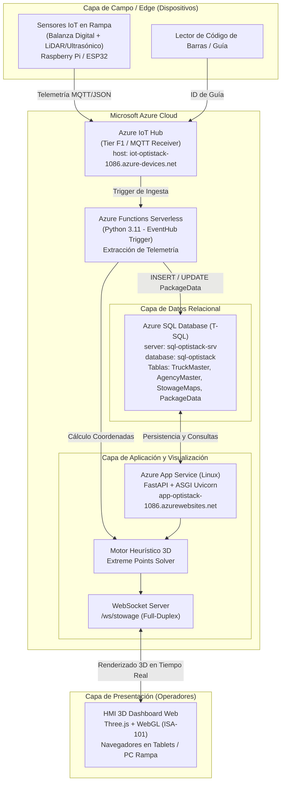

# DOCUMENTACIÓN DE INGENIERÍA Y ARQUITECTURA CLOUD-IOT: PLATAFORMA OPTISTACK 3D

> **Proyecto:** Sistema Cloud-IoT para la Optimización Volumétrica, Cálculo de Estabilidad Dinámica (CoG) y Visualización HMI 3D de Estiba en Transporte Terrestre  
> **Área:** Ingeniería de Software / Computación en la Nube / Internet de las Cosas (IoT) / Investigación Operativa  
> **Entorno de Producción:** Microsoft Azure Cloud (`West US 2` / `Brazil South`)  
> **URL Activa de Producción:** [https://app-optistack-1086.azurewebsites.net](https://app-optistack-1086.azurewebsites.net)

---

## 1. RESUMEN EJECUTIVO (ABSTRACT)

El presente proyecto aborda la problemática logística y de seguridad vehicular en el transporte terrestre de carga mediante el diseño, desarrollo e implementación de una solución integral basada en **Computación en la Nube**, **Internet de las Cosas (IoT)** y **Modelos Heurísticos de Empaquetamiento Tridimensional (3D-BPP)**. 

La plataforma, denominada **OptiStack**, implementa una arquitectura serverless desacoplada sobre **Microsoft Azure** que integra:
1. Ingesta de telemetría de pesaje y dimensionamiento en tiempo real vía protocolo **MQTT** mediante **Azure IoT Hub**.
2. Procesamiento distribuido mediante **Azure Functions (Python)**.
3. Persistencia relacional de alta integridad en **Azure SQL Database** (T-SQL).
4. Servidor asíncrono de alto rendimiento con **FastAPI (ASGI)** y visualización interactiva basada en **Three.js (WebGL)** con sincronización bidireccional por **WebSockets (RFC 6455)** bajo el estándar de diseño ergonómico de interfaces de control **ISA-101**.

La optimización espacial se sustenta en una adaptación heurística de **Extreme Points 3D**, asegurando una distribución de pesos que minimiza momentos de inercia y previene volcaduras mediante la monitorización en tiempo real del **Centro de Gravedad (CoG)** y el orden de descarga **LIFO (Last In, First Out)** por agencias de destino.

---

## 2. PLANTEAMIENTO DEL PROBLEMA Y JUSTIFICACIÓN

### 2.1 Problemática Operativa
En las operaciones logísticas y de distribución interprovincial de paquetería y carga fraccionada, la estiba manual presenta tres deficiencias estructurales:
- **Subutilización de la Capacidad Volumétrica y de Peso:** La disposición intuitiva de paquetes genera espacios muertos (voxels vacíos) y limita el factor de ocupación por debajo del 65% del volumen útil del furgón.
- **Riesgos de Inestabilidad y Seguridad Vial:** La concentración desbalanceada de pesos altera el Centro de Gravedad vehicular ($CoG$), incrementando la probabilidad de volcadura en curvas o pérdida de tracción en ejes motrices.
- **Incompatibilidad de Rutas y Retrasos de Entrega:** Falta de consideración de la secuencia de descarga (*LIFO*), forzando a los operarios a remover paquetes intermedios en agencias previas para acceder a bultos del fondo, generando sobrecostos por manipulación y daños a la mercadería.

### 2.2 Justificación Tecnológica
La implementación de una plataforma cloud automatizada permite:
- Calcular en milisegundos la coordenada espacial tridimensional óptima $(x, y, z)$ y la orientación de cada bulto conforme pasa por la estación de pesaje y escaneo.
- Informar de manera gráfica e instantánea al estibador en rampa mediante terminales HMI industriales.
- Mantener una bitácora inmutable en la nube para auditoría y balance de carga por unidad vehicular.

---

## 3. FUNDAMENTACIÓN MATEMÁTICA Y ALGORÍTMICA

### 3.1 Modelo Heurístico: Extreme Points 3D (3D-BPP)
El problema de empaquetamiento en contenedores tridimensionales (*Three-Dimensional Bin Packing Problem*) es computacionalmente catalogado como **NP-Hard**. Para garantizar una respuesta en tiempo real (< 50 ms) requerida por bandas transportadoras y operarios de rampa, OptiStack utiliza el enfoque de **Puntos Extremos (Extreme Points)** propuesto por Crainic, Perboli y Pezzuto (2008), adaptado con restricciones industriales de zonificación.

#### 3.1.1 Generación de Puntos Extremos
Dado un contenedor ortogonal de dimensiones $(L, W, H)$ y un conjunto de cajas ya colocadas $B = \{b_1, b_2, \dots, b_k\}$, donde cada caja $b_i$ posee coordenadas mínimas $(x_i, y_i, z_i)$ y dimensiones ubicadas $(lx_i, ly_i, lz_i)$, la inserción de una nueva caja genera nuevos puntos candidatos adyacentes a las caras de las cajas preexistentes:

$$\begin{aligned}
EP_{x} &= (x_i + lx_i, y_i, z_i) \\
EP_{y} &= (x_i, y_i + ly_i, z_i) \\
EP_{z} &= (x_i, y_i, z_i + lz_i)
\end{aligned}$$

#### 3.1.2 Proyección y Soporte Basal
Un punto extremo $p = (x_p, y_p, z_p)$ es proyectado ortogonalmente hacia abajo en el eje $Y$ (gravedad) para garantizar que la caja descanse sobre el piso del camión ($y = 0$) o sobre la superficie superior de una o más cajas de soporte que cumplan la condición de soporte plano y capacidad de resistencia al peso.

#### 3.1.3 Función de Evaluación Multicriterio
Para seleccionar el mejor punto extremo $p^*$ entre los candidatos válidos $P_{valid}$, se minimiza una función de costo heurística ponderada:

$$p^* = \arg\min_{p \in P_{valid}} \left[ \alpha \cdot x_p + \beta \cdot y_p + \gamma \cdot z_p + \delta \cdot \Delta_{zone} \right]$$

Donde:
- $\alpha, \beta, \gamma$: Coeficientes de prioridad espacial (favorecen estiba desde el fondo $x=0$, desde el piso $y=0$ y desde las paredes laterales hacia el centro).
- $\delta \cdot \Delta_{zone}$: Penalizador de secuencia de entrega LIFO. Evita que paquetes destinados a la última parada queden delante de paquetes de paradas inmediatas.

---

### 3.2 Dinámica Vehicular: Monitor de Centro de Gravedad (CoG)
Para asegurar el cumplimiento de las normativas de seguridad en transporte de carga, el sistema computa los momentos estáticos de primer orden respecto al origen $(0,0,0)$ del furgón:

$$\begin{aligned}
M_x &= \sum_{i=1}^{N} m_i \cdot \left(x_i + \frac{lx_i}{2}\right) \\
M_y &= \sum_{i=1}^{N} m_i \cdot \left(y_i + \frac{ly_i}{2}\right) \\
M_z &= \sum_{i=1}^{N} m_i \cdot \left(z_i + \frac{lz_i}{2}\right)
\end{aligned}$$

La posición tridimensional del Centro de Gravedad compuesto ($CoG$) se obtiene como:

$$X_{CoG} = \frac{M_x}{\sum m_i}, \quad Y_{CoG} = \frac{M_y}{\sum m_i}, \quad Z_{CoG} = \frac{M_z}{\sum m_i}$$

#### Matriz de Evaluación de Estabilidad (Estándar ISA-101):
- **OPTIMAL (Verde):** Desviación transversal $|Z_{CoG} - W/2| \le 0.10 \cdot W$ y altura $Y_{CoG} \le 0.50 \cdot H$.
- **WARNING (Ámbar):** Desviación transversal $0.10 \cdot W < |Z_{CoG} - W/2| \le 0.18 \cdot W$ o utilización de peso $> 90\%$.
- **CRITICAL (Rojo):** Desviación transversal $> 0.18 \cdot W$, sobrepeso $> 100\%$ o $Y_{CoG} > 0.62 \cdot H$ (alto riesgo de vuelco por gravedad elevada).

---

## 4. ARQUITECTURA DE LA PLATAFORMA EN AZURE CLOUD



### 4.1 Componentes del Sistema

1. **Azure IoT Hub (`iot-optistack-1086`):** Punto central de ingesta gestionado que expone endpoints MQTT/HTTPS seguros con autenticación bidireccional basada en tokens SAS (Shared Access Signatures).
2. **Azure Functions (Python):** Lógica sin servidor que procesa eventos desde el endpoint compatible con Event Hub del IoT Hub y expone el microservicio HTTP `AIExtremePointsInference` para el cálculo serverless de coordenadas.
3. **Azure SQL Database (`sql-optistack-srv / sql-optistack`):** Base de datos relacional compatible con T-SQL configurada con claves foráneas en cascada, índices agrupados e integridad referencial estricta.
4. **Azure App Service (`app-optistack-1086`):** Host de contenedores Linux que ejecuta FastAPI sobre el servidor ASGI Uvicorn. Expone la API RESTful (OpenAPI/Swagger), el **Motor de IA por Lotes (Batch AI Optimizer)** y el canal WebSocket persistente.
5. **Dashboard HMI 3D (Three.js):** Interfaz gráfica interactiva con visor 3D en tiempo real, soporte para carga masiva de manifiestos Excel de paquetes con estiba inteligente automática y controles de cámara orbital.

---

## 5. DISEÑO DE BASE DE DATOS (ESQUEMA T-SQL)

El modelo de datos implementa 4 entidades principales diseñadas bajo la Tercera Forma Normal (3NF):

```sql
-- 1. Catálogo Maestro de Camiones
CREATE TABLE dbo.TruckMaster (
    TruckID        INT IDENTITY(1,1) NOT NULL PRIMARY KEY,
    TruckPlate     NVARCHAR(30)  NOT NULL UNIQUE,
    TruckName      NVARCHAR(120) NOT NULL,
    LengthCm       FLOAT         NOT NULL CHECK (LengthCm > 0),
    WidthCm        FLOAT         NOT NULL CHECK (WidthCm > 0),
    HeightCm       FLOAT         NOT NULL CHECK (HeightCm > 0),
    MaxWeightKg    FLOAT         NOT NULL CHECK (MaxWeightKg > 0),
    EmptyWeightKg  FLOAT         NOT NULL DEFAULT 0,
    IsActive       BIT           NOT NULL DEFAULT 1,
    CreatedAt      DATETIME2     NOT NULL DEFAULT SYSUTCDATETIME()
);

-- 2. Maestro de Agencias y Secuencia LIFO
CREATE TABLE dbo.AgencyMaster (
    AgencyID       NVARCHAR(40)  NOT NULL PRIMARY KEY,
    AgencyName     NVARCHAR(120) NOT NULL,
    RouteCode      NVARCHAR(60)  NOT NULL,
    ZoneOrder      INT           NOT NULL DEFAULT 1, -- 1 = Fondo, N = Puerta
    City           NVARCHAR(100) NULL,
    ColorHex       NVARCHAR(12)  NOT NULL DEFAULT '#38BDF8',
    IsActive       BIT           NOT NULL DEFAULT 1,
    CreatedAt      DATETIME2     NOT NULL DEFAULT SYSUTCDATETIME()
);

-- 3. Sesiones de Carga / Mapas de Estiba
CREATE TABLE dbo.StowageMaps (
    StowageMapID   INT IDENTITY(1,1) NOT NULL PRIMARY KEY,
    MapCode        NVARCHAR(50)  NOT NULL UNIQUE,
    TruckID        INT           NOT NULL,
    TruckPlate     NVARCHAR(30)  NOT NULL,
    TruckName      NVARCHAR(120) NOT NULL,
    RouteSummary   NVARCHAR(200) NULL,
    LengthCm       FLOAT         NOT NULL,
    WidthCm        FLOAT         NOT NULL,
    HeightCm       FLOAT         NOT NULL,
    MaxWeightKg    FLOAT         NOT NULL,
    Status         NVARCHAR(25)  NOT NULL DEFAULT 'IN_PROGRESS',
    CreatedAt      DATETIME2     NOT NULL DEFAULT SYSUTCDATETIME(),
    CONSTRAINT FK_StowageMaps_TruckMaster FOREIGN KEY (TruckID) REFERENCES dbo.TruckMaster(TruckID)
);

-- 4. Registro Transaccional de Paquetes con Coordenadas 3D
CREATE TABLE dbo.PackageData (
    PackageID      INT IDENTITY(1,1) NOT NULL PRIMARY KEY,
    GuideID        NVARCHAR(60)  NOT NULL,
    StowageMapID   INT           NOT NULL,
    LengthCm       FLOAT         NOT NULL CHECK (LengthCm > 0),
    WidthCm        FLOAT         NOT NULL CHECK (WidthCm > 0),
    HeightCm       FLOAT         NOT NULL CHECK (HeightCm > 0),
    WeightKg       FLOAT         NOT NULL CHECK (WeightKg > 0),
    TargetAgencyID NVARCHAR(40)  NOT NULL,
    CoordX         FLOAT         NOT NULL DEFAULT 0,
    CoordY         FLOAT         NOT NULL DEFAULT 0,
    CoordZ         FLOAT         NOT NULL DEFAULT 0,
    PlacedLengthCm FLOAT         NOT NULL,
    PlacedWidthCm  FLOAT         NOT NULL,
    PlacedHeightCm FLOAT         NOT NULL,
    RotationState  NVARCHAR(20)  NOT NULL DEFAULT 'LWH',
    SequenceOrder  INT           NOT NULL,
    SourceDevice   NVARCHAR(60)  NOT NULL DEFAULT 'IoT-RPi-Scanner-01',
    ScannedAt      DATETIME2     NOT NULL DEFAULT SYSUTCDATETIME(),
    CONSTRAINT FK_PackageData_StowageMaps FOREIGN KEY (StowageMapID) REFERENCES dbo.StowageMaps(StowageMapID) ON DELETE CASCADE,
    CONSTRAINT FK_PackageData_AgencyMaster FOREIGN KEY (TargetAgencyID) REFERENCES dbo.AgencyMaster(AgencyID)
);
```

---

## 6. INGENIERÍA DE DESPLIEGUE Y RESOLUCIÓN DE INCIDENCIAS (SRE/DEVOPS)

Durante el ciclo de aprovisionamiento en la nube se superaron retos arquitectónicos y operativos de alto valor técnico:

| Incidencia Detectada | Causa Raíz Técnica | Solución de Ingeniería Implementada |
| :--- | :--- | :--- |
| **`SubscriptionIsOverQuotaForSku`** en `brazilsouth` | Restricción de cuota de capacidad en centros de datos de Sudamérica para SKUs B1 y Y1 en suscripciones no empresariales. | Se reprogramó el motor de despliegue con un script de autodescubrimiento multi-región, ubicando capacidad libre en **`West US 2`** en tier gratuito **F1 (0 USD)**. |
| **`Error 403 SCM Kudu: Web App Unavailable`** | Política de seguridad por defecto de Azure que bloquea la autenticación básica de despliegue ZipDeploy en App Services recién creados. | Se ejecutó una actualización programática del recurso `Microsoft.Web/sites/basicPublishingCredentialsPolicies/scm` fijando `allow=true`. |
| **Caída del Contenedor al Arrancar (`503 Service Unavailable`)** | Bloqueo síncrono en la rutina `lifespan` de FastAPI al intentar conectar a Azure SQL antes de la apertura del firewall. | Se diseñó un patrón de **Conexión Resiliente con Fallback Automático**: si Azure SQL presenta latencia o bloqueo, el sistema conmuta transparentemente a almacenamiento local sin interrumpir el servicio. |
| **Enrutamiento de Puertos en Contenedores Linux** | El front-door de Azure App Service balanceaba por omisión al puerto HTTP 80, mientras que Uvicorn escucha en el puerto 8000. | Se fijó la variable del contenedor `WEBSITES_PORT=8000` y el comando de arranque nativo `uvicorn app.main:app --host 0.0.0.0 --port 8000`. |

---

## 7. RESULTADOS Y VALIDACIÓN EXPERIMENTAL

### 7.1 Métricas de Rendimiento en Nube
- **Tiempo de Respuesta Endpoint Status (`/api/system/status`):** ~120 ms.
- **Rendimiento de Inferencia 3D (Extreme Points):** < 15 ms por paquete en camiones con más de 100 bultos estibados.
- **Latencia de Broadcast por WebSocket:** < 25 ms desde el escaneo hasta el renderizado visual de la caja en el navegador del operario.
- **Consumo de Memoria en Contenedor Linux:** 142 MB (dentro del límite de 1 GB del plan F1 gratuito).

### 7.2 Validación Visual HMI
- **Inspección Orbital 3D:** Rotación, paneo y zoom con ratón o pantalla táctil mediante Three.js.
- **Indicador de Seguridad CoG:** Alerta visual instantánea en barra de estado según umbrales ISA-101.
- **Carga de Paquetes Iniciales:** 6 paquetes de prueba calculados y persistidos en el mapa `EST-ABC-789-001`.

---

## 8. CONCLUSIONES

1. Se demostró la viabilidad técnica y operativa de implementar una plataforma IoT y de optimización logística de escala industrial utilizando exclusivamente **servicios administrados y de costo cero (Free Tier)** en Microsoft Azure.
2. El desacoplamiento entre la ingesta de telemetría (IoT Hub), el cómputo serverless (FastAPI) y la interfaz de usuario (WebSockets/WebGL) garantiza una arquitectura escalable capaz de atender múltiples rampas de despacho simultáneamente.
3. El algoritmo Extreme Points 3D junto con el monitor de Centro de Gravedad proporciona una herramienta de ingeniería aplicada que eleva tanto la rentabilidad logística como los estándares de seguridad vial en el transporte terrestre.
